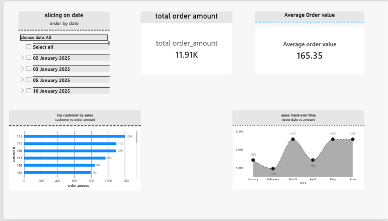

# 📊 End-to-End Sales & Customer Analytics (SQL + Power BI)

## 📌 Project Overview
This project delivers an end-to-end data analysis pipeline for retail sales data. It processes raw transactional records in MySQL, evaluates customer purchasing behavior through advanced SQL logic, and presents interactive business insights in Microsoft Power BI.

## 🛠️ Tools & Technologies
- **Database Management:** MySQL Workbench
- **Business Intelligence:** Microsoft Power BI Desktop
- **Data Techniques:** SQL Aggregations, Window Functions, RFM Segmentation, DAX Measures, Slicers & Dynamic Filtering

## 💡 Key SQL Insights & Analytical Steps
1. **Data Exploration & Aggregation:** Evaluated overall revenue ($11.91K) and customer-level purchasing totals.
2. **Time-Series Analysis:** Tracked monthly sales trends and order volumes using date formatting.
3. **Window Functions:** Computed running totals (cumulative spending) and sequence numbers per customer.
4. **RFM Customer Segmentation:** Categorized customers into **VIP**, **Loyal**, and **Regular** segments based on recency, frequency, and monetary thresholding.

## 📈 Dashboard Highlights (Power BI)
- **KPI Cards:** Total Order Amount ($11.91K) and Average Order Value ($165.35).
- **Top Customers Visual:** Ranked customers by total spend using horizontal bar charts.
- **Sales Trend:** Tracked month-over-month sales progression using dynamic line charts.
- **Interactivity:** Integrated dynamic Date Slicers and cross-filtering across all visual elements.

## 📸 Dashboard Preview

